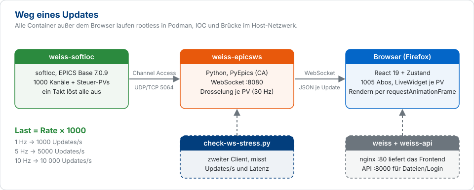
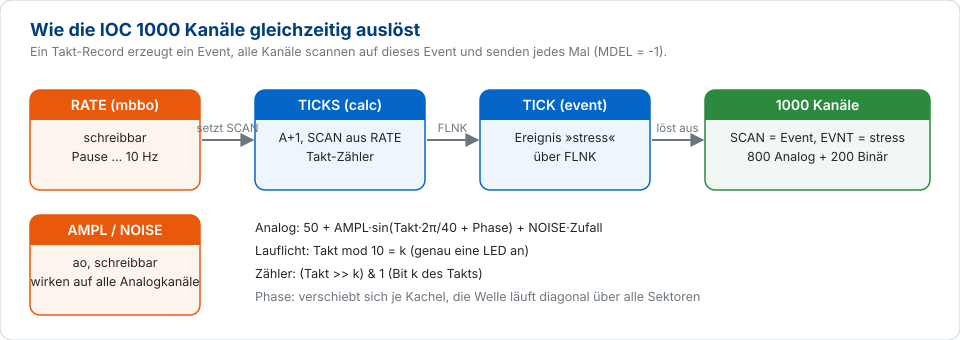
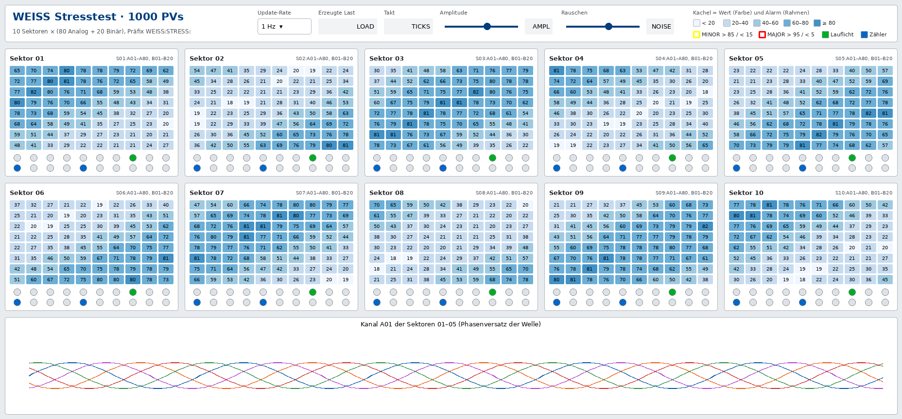
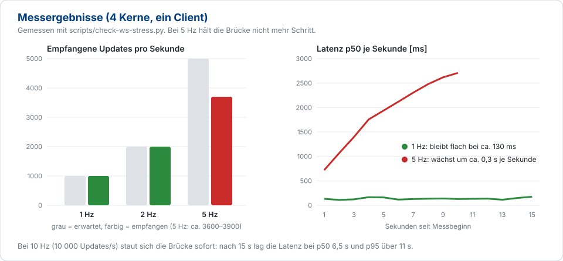

# WEISS-Stresstest mit 1000 EPICS-PVs

Ein Hardcore-Test für die gesamte Kette **IOC → `weiss-epicsws` → WebSocket → Browser**. Eine
Test-SoftIOC erzeugt 1000 PVs, die alle im gleichen Takt Updates senden. Ein fertiges WEISS-Display
zeigt jede PV als eigenes Widget. So siehst du, wie viele Updates pro Sekunde das System schafft,
bevor es in Rückstand gerät.

| | |
|---|---|
| **Kanäle** | 1000 PVs (800 Analog, 200 Binär) in 10 Sektoren, dazu Steuer-PVs |
| **Last** | Update-Rate × 1000, einstellbar von Pause bis 10 Hz (10 000 Updates/s) |
| **Display** | `examples/weiss-stress-1000.opi.json`, etwa 1065 Widgets, 1005 Abos im Browser |
| **Messung** | im Browser (Takt, Lauflicht) oder ohne Browser mit `scripts/check-ws-stress.py` |
| **Ergebnis hier** | stabil bis 2 Hz (2000 Updates/s), bei 5 Hz staut sich die Brücke |

## Inhalt

1. [Aufbau](#1-aufbau)
2. [Die Kanäle](#2-die-kanäle)
3. [Das Display](#3-das-display)
4. [Schnellstart](#4-schnellstart)
5. [Last steuern](#5-last-steuern)
6. [Messen: wie nah am Limit?](#6-messen-wie-nah-am-limit)
7. [Messergebnisse](#7-messergebnisse)
8. [Mehr oder weniger PVs](#8-mehr-oder-weniger-pvs)
9. [Fehlersuche](#9-fehlersuche)
10. [Dateien](#10-dateien)

---

## 1. Aufbau



Jeder Kanal sendet bei **jedem Takt** ein Update, auch wenn sich der Wert nicht ändert
(`MDEL = -1`). Die Last ist deshalb genau `Rate × 1000` Updates pro Sekunde und hängt nicht davon
ab, wie sich die Werte entwickeln. Das macht Messungen reproduzierbar.

Die IOC löst alle Kanäle mit einem einzigen Ereignis aus. Dadurch kommen die 1000 Updates fast
gleichzeitig an der Brücke an. Das ist eine harte Lastspitze, aber auch ein klares Signal: Wenn
das System Updates verzögert, sieht man es im Display sofort.



## 2. Die Kanäle

Alle Namen beginnen mit `WEISS:STRESS:`. `ss` steht für die Sektornummer `01` bis `10`.

| PV | Anzahl | Typ | Inhalt |
|---|---|---|---|
| `S<ss>:A01` … `A80` | 800 | calc | Sinus um 50 mit Periode 40 Takten, Phasenversatz je Kachel, etwas Rauschen |
| `S<ss>:B01` … `B10` | 100 | calc | **Lauflicht**: `Takt mod 10 = k`, genau eine LED je Sektor ist an |
| `S<ss>:B11` … `B20` | 100 | calc | **Binärzähler**: Bit 0 bis 9 des Takts |
| `RATE` | 1 | mbbo | **schreibbar**: Pause, 0.1, 0.5, 1 (Start), 2, 5, 10 Hz |
| `AMPL` | 1 | ao | **schreibbar**: Amplitude 0..60 (Start 30) |
| `NOISE` | 1 | ao | **schreibbar**: Rauschen 0..20 (Start 2) |
| `TICKS` | 1 | calc | Taktzähler |
| `LOAD` | 1 | calc | erzeugte Updates pro Sekunde (Rate × 1000) |
| `COUNT` | 1 | longin | Anzahl der Kanäle |

**Alarme.** Die Analogkanäle haben Grenzwerte. Mit der Amplitude steuerst du, wie viele Alarmrahmen
im Display erscheinen:

| Wertebereich | Alarm | Rahmen im Display | Ab Amplitude |
|---|---|---|---|
| 15 … 85 | keiner | – | bis 35 |
| > 85 oder < 15 | MINOR | gelb | ab 35 |
| > 95 oder < 5 | MAJOR | rot | ab 45 |

Der Wert ist `50 + AMPL · sin(Takt · 2π/40 + Phase) + NOISE · Zufall`. Bei Amplitude 30 liegt er
zwischen etwa 20 und 80 und löst deshalb **keinen** Alarm aus.

## 3. Das Display

`examples/weiss-stress-1000.opi.json` ist ein natives WEISS-Display und braucht keinen Import.



*Die Abbildung ist eine aus der Display-Datei gerenderte Vorschau, kein Bildschirmfoto. Werte und
Farben sind simuliert. Rate, Takt, Last, Amplitude und Rauschen zeigen hier nur ihren PV-Namen.*

| Bereich | Widgets | Was du siehst |
|---|---|---|
| **Kopfzeile** | Auswahlbox, 4 Textfelder, 2 Regler, Legende | Rate umschalten, Last und Takt ablesen, Amplitude und Rauschen ändern |
| **10 Sektoren** | je 80 Zahlenkacheln (TextUpdate) | Wert als Zahl. Die Hintergrundfarbe kommt aus einer Regel in 5 Blaustufen, der Rahmen ist der WEISS-Alarmrahmen |
| **LED-Zeilen** | je 2 × 10 BitIndicator | obere Zeile grün: Lauflicht, untere Zeile blau: Binärzähler |
| **Trend** | GraphY | Kanal `A01` der Sektoren 01 bis 05 über die Zeit |

### Wie liest man das Display?

Du musst keine Zahlen vergleichen. Drei optische Prüfungen genügen:

| Beobachtung | Bedeutung |
|---|---|
| Die Welle läuft gleichmäßig diagonal über alle Sektoren | alles in Ordnung |
| Ein Bereich bleibt stehen oder zuckt | dort kommen keine oder verspätete Updates an |
| Lauflicht: **genau eine** grüne LED je Sektor | alles in Ordnung |
| Lauflicht: zwei oder keine grüne LED | Updates gehen verloren oder kommen verspätet |
| Binärzähler und Lauflicht laufen in allen Sektoren synchron | alle Sektoren sind auf demselben Stand |
| Ein Sektor hinkt den anderen hinterher | der Browser oder die Brücke kommt nicht hinterher |

## 4. Schnellstart

**1. IOC mit Stresstest bauen und starten** (die Kanäle sind in `softioc/st.cmd` bereits geladen):

```sh
podman compose build weiss-softioc
podman compose up -d weiss-softioc
podman exec weiss-softioc caget WEISS:STRESS:COUNT WEISS:STRESS:LOAD    # 1000 und 1000
```

Mit Quadlet: `scripts/build-images.sh --with-softioc && systemctl --user restart softioc`.

**2. Brücke prüfen.** Direkt nach dem Start braucht `weiss-epicsws` einige Sekunden, um alle 1000
Kanäle zu verbinden:

```sh
~/weiss-check/bin/python scripts/check-ws-stress.py --duration 10
```

Erwartet wird `OK: alle PVs liefern Werte in voller Rate`. Das Skript braucht `websockets`
(`python3 -m venv ~/weiss-check && ~/weiss-check/bin/pip install websockets`).

**3. Display hochladen.** In WEISS (als Developer) im Projektbaum den Zielordner wählen und in der
Datei-Toolbar **Upload file** benutzen. Datei: `examples/weiss-stress-1000.opi.json`. Danach die
Datei öffnen und oben auf **Runtime** umschalten.

## 5. Last steuern

Die Rate stellst du im Display mit der Auswahlbox ein, oder auf der Kommandozeile:

```sh
podman exec weiss-softioc caput WEISS:STRESS:RATE "5 Hz"
podman exec weiss-softioc caput WEISS:STRESS:RATE "Pause"
podman exec weiss-softioc caput WEISS:STRESS:AMPL 50       # viele Alarmrahmen
```

| Einstellung | Updates/s | Zweck |
|---|---|---|
| Pause | 0 | Ruhezustand, Brücke und Browser leeren ihre Warteschlangen |
| 0.1 / 0.5 Hz | 100 / 500 | Funktionstest, alle 1000 PVs verbinden |
| 1 Hz | 1000 | Normalbetrieb für den Test |
| 2 Hz | 2000 | anspruchsvoll, hier noch stabil |
| 5 Hz | 5000 | Grenzbereich, Brücke staut sich |
| 10 Hz | 10 000 | Überlast |

**Vorgehen:** Stufenweise erhöhen und jede Stufe etwa 30 Sekunden beobachten. Die erste Stufe, bei
der der Rückstand wächst, ist das Limit. Danach auf **Pause** stellen und kurz warten, bevor du die
nächste Messung beginnst, sonst misst du noch den Stau der vorherigen.

## 6. Messen: wie nah am Limit?

Das **Kriterium** ist die Latenz, nicht die CPU: Unter dem Limit bleibt sie konstant bei 100 bis
300 ms. Über dem Limit wächst sie mit jeder Sekunde weiter. Die CPU-Werte sind nur ein Hinweis, wo
der Engpass liegt.

### a) Latenz der Brücke (ohne Browser)

```sh
~/weiss-check/bin/python scripts/check-ws-stress.py --rate 2 --duration 30
```

Das Skript abonniert alle Kanäle wie der Browser und gibt jede Sekunde eine Zeile aus. Es stellt am
Ende die vorherige Rate wieder her.

```
 Sek  Updates/s  aktive PVs  Latenz p50/max [ms]
   1       2006        1000    129.8 /   269.4
```

| Spalte | Bedeutung |
|---|---|
| Updates/s | empfangene Updates, soll der erwarteten Rate entsprechen |
| aktive PVs | PVs mit einem Update in der letzten Sekunde, soll 1000 sein |
| Latenz p50/max | Zeit vom IOC-Zeitstempel bis zum Empfang. **Wächst sie von Zeile zu Zeile, staut sich die Brücke** |

Das Skript ist selbst ein zweiter Client und erhöht die Last. Läuft es parallel zum Browser, fällt
das Ergebnis etwas pessimistischer aus. Der Exit-Code ist 0, wenn mindestens 95 % der erwarteten
Updates ankamen.

### b) Rückstand im Browser

Vergleiche den **Takt** im Display mit dem Takt der IOC:

```sh
podman exec weiss-softioc camonitor WEISS:STRESS:TICKS        # oder caget -t
```

Lies den Takt im Display in dem Moment ab, in dem im Terminal eine neue Zeile erscheint:

| Unterschied | Bedeutung |
|---|---|
| 0 bis 1 Takt | normale Übertragungszeit |
| konstant 2 bis 3 Takte | das System puffert, hält aber noch Schritt |
| wächst über Minuten | die Kette ist überlastet |

### c) CPU: wo liegt der Engpass?

```sh
podman stats weiss-epicsws                                    # CPU % der Brücke
BR=$(podman top weiss-epicsws hpid | tail -1)
top -H -p "$BR"                                               # einzelne Threads
```

**Prozente gelten pro Kern.** 100 % ist ein voll ausgelasteter Kern. Die Brücke hat über 20 Threads
und kann deshalb mehr als 100 % anzeigen (auf diesem 4-Kern-Rechner bis 400 %). Beim Test sah die
Verteilung bei 5 Hz so aus:

| Thread | CPU | Aufgabe |
|---|---|---|
| `CAC-TCP-recv` | ca. 40 % | nimmt die Werte der IOC entgegen (PyEpics) |
| `python` (Hauptthread) | ca. 30 % | asyncio-Schleife: serialisiert und sendet an die Browser |
| `uvloop_0` … `uvloop_5` | je ca. 8 % | Hilfsthreads |

Python-Code läuft wegen des GIL trotzdem nur in einem Thread gleichzeitig. Die Summe der Threads
sagt deshalb nicht, wie viel Reserve noch bleibt. Liegt die Latenz bei geringer Thread-Auslastung
im Wachstum, ist das ein Hinweis auf GIL-Konkurrenz.

Für den Browser öffnest du in Firefox `about:processes` und siehst die Last des Tabs mit WEISS. In
den Entwicklerwerkzeugen (F12) zeigt der Reiter **Performance**, wie viel Zeit auf das Zeichnen der
Widgets und wie viel auf das Verarbeiten der WebSocket-Nachrichten entfällt.

## 7. Messergebnisse



Testrechner mit 4 Kernen, ein Client, Brücke und IOC als Container im Host-Netzwerk:

| Rate | Erwartet | Empfangen | Latenz p50 / p95 | Ergebnis |
|---|---|---|---|---|
| 1 Hz | 1000/s | 1000/s | 133 / 265 ms | stabil |
| 2 Hz | 2000/s | 1997/s | 139 / 279 ms | stabil |
| 5 Hz | 5000/s | ca. 3600 bis 3900/s | steigt um ca. 0,3 s je Sekunde | überlastet |
| 10 Hz | 10 000/s | – | p50 6,5 s, p95 über 11 s nach 15 s | überlastet |

**Beobachtung im Browser bei 2 Hz:** Das Lauflicht zeigte in allen 10 Sektoren genau eine grüne LED,
die Welle lief gleichmäßig, und die Brücke lag bei etwa 60 % CPU (Durchschnitt 54 %).

**Was die Messung aussagt:**

- Die Grenze liegt bei `weiss-epicsws`. Ab etwa 4000 Updates/s kommen die Werte immer später an.
  Sie gehen nicht verloren, die Verzögerung wächst aber ständig.
- `EPICS_MAX_CLIENT_QUEUE` greift dabei nicht, weil sich der Stau vor der Sendewarteschlange des
  Clients bildet. Die Brücke trennt den Client daher nicht, es gibt keine Fehlermeldung.
- Bei 10 Hz hängt das Ergebnis davon ab, wie viel Stau noch von vorherigen Messungen übrig ist. Der
  Wert ist deshalb nicht belastbar. Eindeutig ist nur: Die Brücke kommt nicht hinterher.

**Einschränkungen:**

- Gemessen mit **einem** Client. Mehrere Browser gleichzeitig senken die Grenze.
- Ein Virenscanner oder EDR-Dienst auf dem Testrechner (hier `event_collector`) belegte zeitweise
  bis zu einen Kern und senkt die erreichbare Rate.
- Die 5-Hz-Werte schwankten zwischen den Läufen (3565/s und 3906/s). Die Messreihe zeigt den
  typischen Verlauf, keinen Garantiewert.
- Das Zeichnen im Browser wird mit `check-ws-stress.py` **nicht** gemessen. Dafür gibt es das
  Lauflicht und den Takt-Vergleich in Abschnitt 6b.

## 8. Mehr oder weniger PVs

Der Generator erzeugt IOC-Kanäle und Display aus denselben Layout-Konstanten:

```sh
python3 scripts/gen-stress.py --sectors 50    # 5000 PVs (1 bis 99 Sektoren, je 100 PVs)
```

Er schreibt `softioc/stress.substitutions` und `examples/weiss-stress-<N>.opi.json`. Danach das
IOC-Image neu bauen (Abschnitt 4) und das neue Display hochladen. `check-ws-stress.py` kennt die
Sektorzahl über `--sectors`.

| Sektoren | PVs | Updates/s bei 1 Hz | Anmerkung |
|---|---|---|---|
| 10 | 1000 | 1000 | Standard, hier ausgemessen |
| 25 | 2500 | 2500 | nicht ausgemessen |
| 50 | 5000 | 5000 | nicht ausgemessen, liegt über der gemessenen Grenze |

Die Sektoren stehen in 5 Spalten nebeneinander. Das Display hat bei 1000 PVs rund 1065 Widgets,
bei 5000 PVs entsprechend fünfmal so viele. Das Hochladen und Öffnen im Editor dauert dann spürbar
länger. Die Dateigröße ist bei 1000 PVs etwa 1,3 MB. Die Obergrenze für Uploads liegt in WEISS bei
10 MB.

## 9. Fehlersuche

| Symptom | Ursache und Lösung |
|---|---|
| Kacheln bleiben leer | IOC läuft nicht oder ohne Stresstest: `podman exec weiss-softioc caget WEISS:STRESS:COUNT` |
| Nach dem IOC-Start fehlen einzelne Kanäle | die Brücke verbindet erst nach einigen Sekunden alle 1000 PVs, kurz warten |
| `check-ws-stress.py`: „kein Wert für WEISS:STRESS:RATE“ | IOC-Image ohne Stresstest, neu bauen |
| Lauflicht zeigt zwei grüne LEDs | Updates verspätet: Rate senken, Takt-Rückstand prüfen |
| Latenz steigt bei konstanter Rate | über dem Limit, Rate senken und die Warteschlange abwarten |
| Messung nach Rate-Wechsel wirkt zu schlecht | Stau der vorherigen Stufe: auf **Pause** stellen und kurz warten |
| Upload des Displays wird abgelehnt | Datei muss auf `.opi.json` enden und unter 10 MB liegen |
| Alarmrahmen fehlen | bei Amplitude 30 gibt es keine, ab 35 erscheinen MINOR-Rahmen |

## 10. Dateien

| Datei | Zweck |
|---|---|
| `softioc/stress-ai.template` | Analogkanal |
| `softioc/stress-bi.template` | Binärkanal (Lauflicht und Zähler) |
| `softioc/stress-control.template` | Takt, Rate, Amplitude, Rauschen, Last |
| `softioc/stress.substitutions` | **erzeugt**: die 1000 Kanäle, nicht von Hand ändern |
| `softioc/st.cmd` | lädt die Stresstest-Kanäle beim Start der IOC |
| `examples/weiss-stress-1000.opi.json` | **erzeugt**: das Display |
| `scripts/gen-stress.py` | Generator für Kanäle und Display |
| `scripts/check-ws-stress.py` | Lasttest der Brücke ohne Browser |
| `docs/img/` | Grafiken dieser Anleitung |
